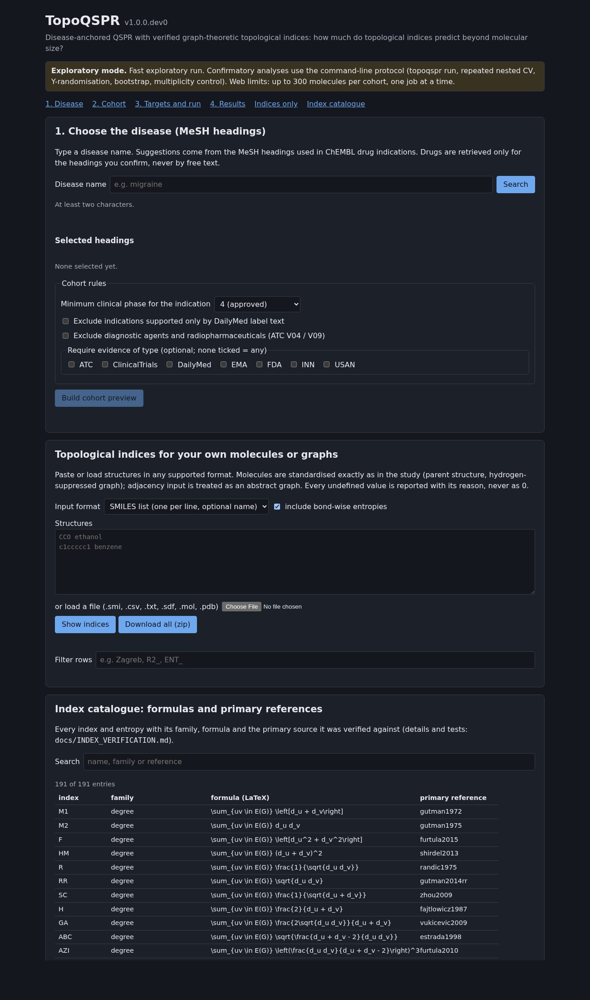
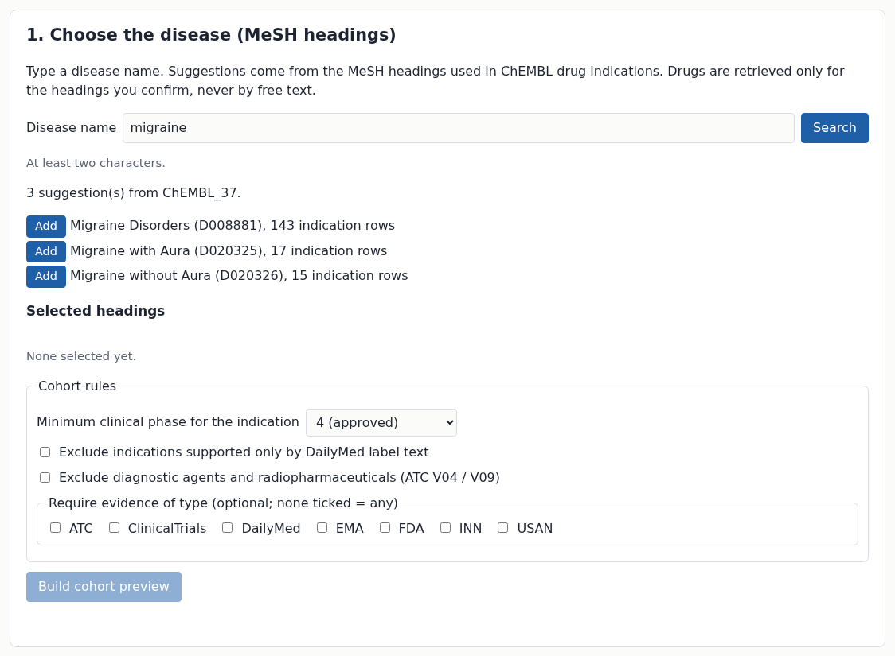
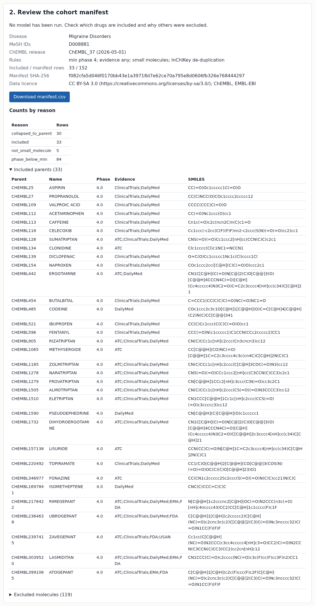
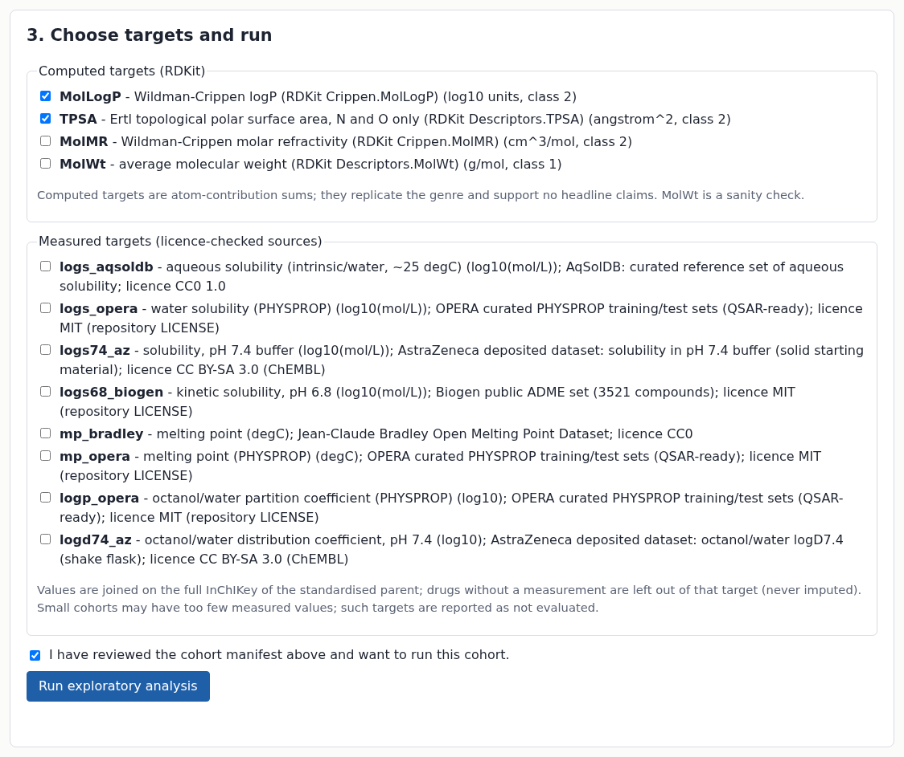
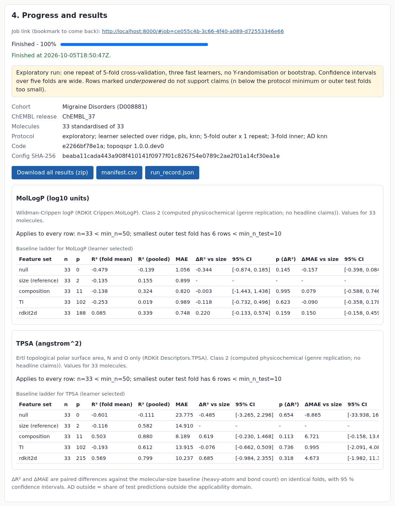
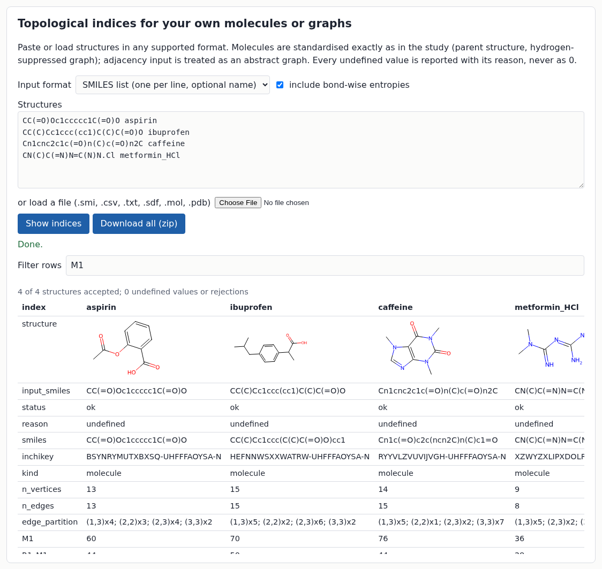
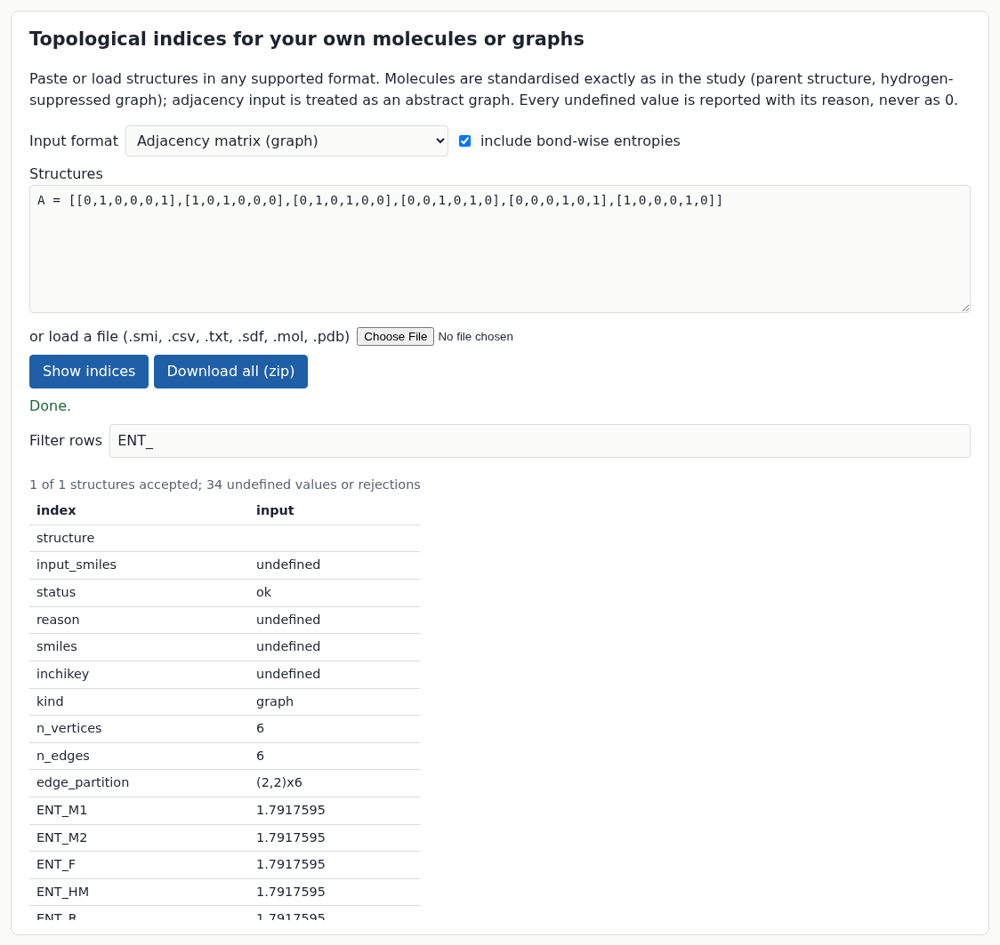
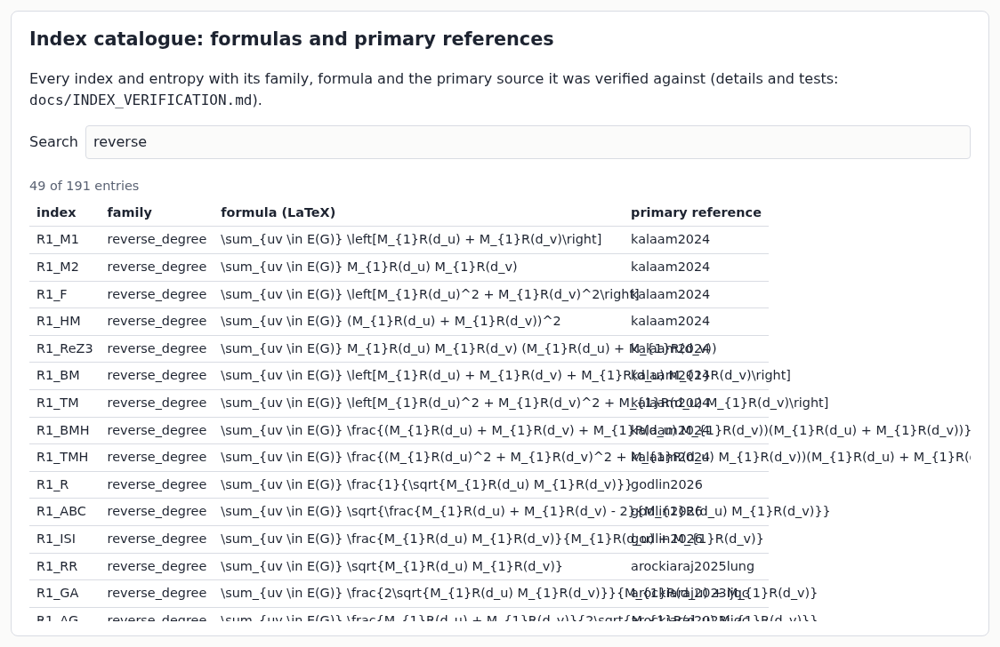

# TopoQSPR web interface (v1.0)

FastAPI application `topoqspr.web.app:app` on top of the v1.0 package. The live site
moleculens.onrender.com still runs the v0.x prototype from `main` until this branch is merged and
deployed (see Deployment).

## What it does

1. **Disease → drug set:** search MeSH headings (`/api/headings`), build the controlled cohort
   (`/api/cohort`) and review the full manifest (included and excluded drugs with reasons, ChEMBL
   release) **before** anything is computed; download it as CSV.
2. **Run:** after explicit confirmation (`/api/run`), a queued job computes the verified indices and
   the baseline ladder (null, size, composition, TI, RDKit 2D) for the chosen computed and measured
   targets. Web mode is *exploratory*: ridge/PLS/kNN, 5-fold × 1 repeat, no permutation or
   bootstrap; the confirmatory protocol runs from the command line (`docs/PIPELINE.md`).
3. **Results:** ladder table with ΔR² and ΔMAE against size, 95 % CIs, underpowered flags and
   applicability-domain coverage; downloads: results zip with `run_record.json` and data-licence
   notes, manifest CSV.
4. **Indices for any structure or graph** (`/api/indices`): SMILES lists, SDF, MOL, PDB, adjacency
   matrix or list; 102 verified indices plus 89 bond-wise entropies; on-page table (`view: true`)
   or zip download (with `catalog.csv`). Undefined values carry a reason, never 0.
5. **Catalogue** (`/api/catalog`): every index and entropy with family, LaTeX formula and primary
   reference.

## Reliability and security

Persistent jobs (SQLite + on-disk results; a restart never loses a job silently), one background
worker, unguessable job IDs, per-IP rate limits, request-size and molecule caps, timeouts, strict
input validation, restricted CORS, no `innerHTML` with server strings, path-safe downloads, and a
`/health` endpoint. Tests: `tests/test_web.py` (offline, FastAPI TestClient; needs `httpx`).

## Run locally

```bash
pip install -e ".[web]" httpx
TOPOQSPR_WEB_DATA_DIR=./webdata uvicorn topoqspr.web.app:app --port 8000
```

## Measured (2026-10-05, this machine under full load from the main experiment)

| Request | Time |
|---|---|
| page load | 0.11 s |
| one molecule, 102 indices + 89 entropies, on-page table | 0.73–0.82 s |
| 50 molecules, same | 7.2 s |

## Deployment

`render-v1.yaml` starts `uvicorn topoqspr.web.app:app`. Deploying replaces the v0.x site and needs
the Render account that hosts moleculens.onrender.com.

## Screenshots (2026-10-05, local, light theme)

Taken by `tools/web_screenshots.mjs` (headless Chrome over the DevTools protocol), on the quarantined
pilot disease (Migraine Disorders) only.

| | |
|---|---|
| Home page (full) |  |
| 1. Disease search |  |
| 2. Cohort manifest review (before any model runs) |  |
| 3. Targets and explicit confirmation |  |
| 4. Results: baseline ladder with ΔR², ΔMAE, CIs, run record |  |
| Indices for drugs (structures, edge partitions) |  |
| Indices for a graph (adjacency matrix) with entropies |  |
| Index catalogue (formulas, primary references) |  |
